# YANGS – Architecture and Database Design

Status: draft for owner approval (2026-11-18).
Authority: `docs/YANGS_SPEC.md` and `CLAUDE.md`. Where this document and the spec disagree, the spec wins and this document is corrected.

## 0. Intent

YANGS is one small bar. The owner wants every peso and every bottle accounted for: what was sold, what it cost, what was spent, who did what. Cashiers want a fast tablet screen that never blocks service. The design below favors correctness of money and stock first, then speed of the cashier flow, then everything else.

**Goals**
- Open tabs per table, many rounds per visit, one consolidated bill, split/partial payments.
- Stock and cost tracked from purchase to sale, including case-to-bottle and bottle-to-shot.
- Profit and loss that never double counts.
- Full audit trail; no silent edits to history.
- One backend for Blade today and a mobile app later (`/api/v1`).

**Non-goals (for now)**
- BIR-accredited official receipts. System receipts are customer bills and internal records; official receipts stay on the existing BIR-registered method.
- Multi-branch, kitchen display, online ordering, loyalty, reservations calendar.
- Supplier payables (accounts payable). Stock receipts are recorded as received; payment to supplier is outside the system.
- Automatic government contribution tables (SSS, PhilHealth, Pag-IBIG, withholding tax). Entered as manual payroll deductions.
- Senior Citizen / PWD discount (not selected by the owner; see Open Questions).
- Receipt printer integration (no printer yet; on-screen and PDF only).

**Anti-goals (failure even if it "works")**
- A bill marked Paid without payments covering it.
- A price or cost change that alters past sales.
- A cashier stalled at a busy hour because the system's stock count is wrong.
- Profit that counts a stock purchase as an expense and again as COGS.
- Dashboard numbers that do not come from real records.

## 1. Owner decisions (from Q&A on 2026-11-18)

| Topic | Decision |
|---|---|
| VAT | Setting, off by default. When on, prices are VAT-inclusive at the configured rate (12%) and receipts show the breakdown. |
| Discounts | Manual percent or fixed amount, on a line or on the whole bill. Complimentary = 100% line discount. No promos, no Senior/PWD. |
| Tab actions | Move tab to another table, merge two tabs, split items into a separate bill, counter/walk-in sales. |
| Zero or negative stock | Allow the sale, let stock go negative, flag it and notify. Never block service. |
| Void / refund approval | Users with the permission act directly; others need a supervisor's PIN on the same device. Both users are logged. |
| Cash drawer | Cashier shifts with opening float, cash in/out, counted cash at close, variance. |
| Attendance | Recorded by owner or supervisor (no employee self clock-in). |
| Printing | No printer yet. Receipts on screen and as PDF, laid out at 80mm so a printer can be added later. |

## 2. Entity-relationship diagram

Conventions used in every table unless stated:
- `id bigint` identity primary key; `created_at` / `updated_at` are `timestamptz`.
- Money totals `decimal(12,2)`. Unit costs `decimal(14,6)` (see 3.3). Stock quantities `decimal(12,3)`.
- Enum-like columns are `varchar` with a `CHECK` constraint, mapped to PHP backed enums in `app/Enums`.
- "Append-only" tables have no `updated_at` and a PostgreSQL trigger that rejects `UPDATE` and `DELETE`.
- `*_by` columns reference `users.id`.

```mermaid
erDiagram
    %% ---------- Access, audit, system ----------
    users {
        bigint id PK
        bigint employee_id FK "nullable, unique"
        string username UK
        string name
        string email "nullable, unique"
        string password "hashed"
        string approval_pin "hashed, nullable"
        boolean is_active
        timestamptz last_login_at
    }
    roles {
        bigint id PK
        string name UK
        string guard_name
        boolean is_locked "Owner role"
    }
    permissions {
        bigint id PK
        string name UK "module.action"
        string guard_name
    }
    model_has_roles {
        bigint role_id FK
        string model_type
        bigint model_id FK
    }
    role_has_permissions {
        bigint permission_id FK
        bigint role_id FK
    }
    settings {
        string key PK
        jsonb value
        bigint updated_by FK
        timestamptz updated_at
    }
    activity_logs {
        bigint id PK
        bigint user_id FK "nullable"
        string user_name "snapshot"
        bigint approved_by FK "nullable, PIN approver"
        string action "e.g. payment.recorded"
        string subject_type
        bigint subject_id
        jsonb old_values
        jsonb new_values
        string ip_address
        timestamptz created_at "append-only"
    }
    notifications {
        uuid id PK
        string type
        string notifiable_type
        bigint notifiable_id
        jsonb data
        timestamptz read_at
    }

    %% ---------- Tables, sessions, orders ----------
    dining_tables {
        bigint id PK
        string code UK "T1, BAR, TAKEOUT"
        string name
        string kind "table|counter|takeout"
        int seats "nullable"
        string manual_status "available|reserved|cleaning|out_of_service"
        int sort_order
        boolean is_active
    }
    table_sessions {
        bigint id PK
        string reference UK "receipt number"
        bigint dining_table_id FK
        bigint parent_session_id FK "split bill, nullable"
        bigint merged_into_id FK "nullable"
        string status "open|billing|closed|cancelled|merged"
        string customer_name "nullable"
        int guest_count "nullable"
        bigint opened_by FK
        timestamptz opened_at
        bigint closed_by FK
        timestamptz closed_at
        date business_date "set at close"
        decimal gross_total "frozen at close"
        decimal discount_total "frozen at close"
        decimal net_total "frozen at close"
        decimal vat_rate "frozen at close, null if VAT off"
        decimal vat_amount "frozen at close"
    }
    orders {
        bigint id PK
        string reference UK
        bigint table_session_id FK
        bigint created_by FK
        timestamptz sent_at
        string note
    }
    order_items {
        bigint id PK
        bigint order_id FK
        bigint product_variant_id FK
        string product_name "snapshot"
        string variant_name "snapshot"
        decimal unit_price "12,2 snapshot"
        decimal unit_cost "14,6 snapshot"
        int quantity
        string note
    }
    order_item_voids {
        bigint id PK
        bigint order_item_id FK
        int quantity
        string reason
        boolean return_to_stock
        date business_date
        bigint voided_by FK
        bigint approved_by FK "nullable"
        timestamptz created_at "append-only"
    }
    discounts {
        bigint id PK
        bigint table_session_id FK
        bigint order_item_id FK "null = whole bill"
        string type "percent|amount"
        decimal value
        decimal amount "frozen at close"
        string reason
        bigint applied_by FK
        bigint approved_by FK "nullable"
        timestamptz voided_at
        bigint voided_by FK
    }

    %% ---------- Payments and cash ----------
    payment_methods {
        bigint id PK
        string code UK "cash, gcash"
        string name
        boolean is_cash
        boolean requires_reference
        boolean is_active
        int sort_order
    }
    payments {
        bigint id PK
        bigint table_session_id FK
        bigint payment_method_id FK
        bigint cashier_shift_id FK
        decimal amount "applied to bill"
        decimal tendered "cash only"
        decimal change_given "cash only"
        string reference_no "GCash ref"
        date business_date
        bigint received_by FK
        timestamptz created_at "append-only"
    }
    refunds {
        bigint id PK
        bigint table_session_id FK
        bigint payment_method_id FK
        bigint cashier_shift_id FK
        decimal amount
        string reason
        date business_date
        bigint refunded_by FK
        bigint approved_by FK "nullable"
        timestamptz created_at "append-only"
    }
    cashier_shifts {
        bigint id PK
        bigint user_id FK
        string status "open|closed"
        decimal opening_float
        decimal expected_cash "frozen at close"
        decimal counted_cash
        decimal variance
        timestamptz opened_at
        timestamptz closed_at
        string note
    }
    cash_movements {
        bigint id PK
        bigint cashier_shift_id FK
        string type "cash_in|cash_out"
        decimal amount
        string reason
        string source_type "expense, stock_receipt, advance, payroll, null"
        bigint source_id
        bigint created_by FK
        timestamptz created_at "append-only"
    }

    %% ---------- Catalog ----------
    categories {
        bigint id PK
        string name UK
        int sort_order
        boolean is_active
        timestamptz deleted_at
    }
    products {
        bigint id PK
        bigint category_id FK
        string name
        text description
        string image_path
        boolean is_available
        boolean is_active
        timestamptz deleted_at
    }
    product_variants {
        bigint id PK
        bigint product_id FK
        string name "Regular, Bucket of 6, Shot"
        string sku UK "nullable"
        decimal price "12,2"
        decimal manual_unit_cost "14,6, used only without recipe"
        boolean is_default
        boolean is_active
        int sort_order
    }
    price_histories {
        bigint id PK
        bigint product_variant_id FK
        string field "price|manual_unit_cost"
        decimal old_value
        decimal new_value
        bigint changed_by FK
        timestamptz created_at "append-only"
    }
    recipe_components {
        bigint id PK
        bigint product_variant_id FK
        bigint inventory_item_id FK
        decimal quantity "base units per 1 sold"
    }

    %% ---------- Inventory ----------
    suppliers {
        bigint id PK
        string name
        string contact_person
        string phone
        string email
        string address
        boolean is_active
        timestamptz deleted_at
    }
    inventory_items {
        bigint id PK
        string name UK
        string sku "nullable"
        string base_unit "bottle, ml, pc"
        decimal on_hand "cached from ledger"
        decimal avg_unit_cost "14,6 per base unit"
        decimal low_stock_threshold
        boolean is_active
        timestamptz deleted_at
    }
    inventory_units {
        bigint id PK
        bigint inventory_item_id FK
        string name "case, bottle"
        decimal factor "base units per unit"
    }
    stock_receipts {
        bigint id PK
        string reference UK
        bigint supplier_id FK "nullable"
        string invoice_no
        timestamptz received_at
        date business_date
        bigint received_by FK
        decimal total_cost
        string status "posted|voided"
        bigint voided_by FK
        timestamptz voided_at
        string void_reason
        text notes
    }
    stock_receipt_items {
        bigint id PK
        bigint stock_receipt_id FK
        bigint inventory_item_id FK
        bigint inventory_unit_id FK "nullable = base unit"
        string unit_name "snapshot"
        decimal unit_factor "snapshot"
        decimal quantity "in that unit"
        decimal base_quantity
        decimal line_cost "12,2"
        decimal base_unit_cost "14,6"
    }
    inventory_movements {
        bigint id PK
        bigint inventory_item_id FK
        string type "receipt|receipt_void|sale|void_return|adjustment"
        decimal quantity "signed, base units"
        decimal unit_cost "14,6 snapshot"
        decimal total_cost "12,2"
        decimal balance_after
        string reason "adjustments: damaged|expired|missing|internal_use|found|other"
        string note
        string source_type
        bigint source_id
        date business_date
        bigint created_by FK
        timestamptz created_at "append-only"
    }

    %% ---------- Expenses ----------
    expense_categories {
        bigint id PK
        string name UK
        boolean is_active
    }
    expenses {
        bigint id PK
        bigint expense_category_id FK
        string description
        decimal amount
        date expense_date
        string attachment_path
        bigint recorded_by FK
        timestamptz voided_at
        bigint voided_by FK
        string void_reason
    }

    %% ---------- Staff ----------
    employees {
        bigint id PK
        string employee_no UK
        string first_name
        string last_name
        string phone
        string email
        string address
        string position
        string employment_status "active|on_leave|resigned|terminated"
        date date_hired
        date date_separated
        string pay_type "hourly|daily|weekly|monthly|custom"
        decimal base_rate
        string emergency_contact_name
        string emergency_contact_phone
        timestamptz deleted_at
    }
    shifts {
        bigint id PK
        string name "Morning, Evening"
        time start_time
        time end_time "earlier than start = crosses midnight"
        boolean is_active
    }
    schedules {
        bigint id PK
        bigint employee_id FK
        bigint shift_id FK "nullable = custom"
        timestamptz starts_at
        timestamptz ends_at
        date duty_date "business date"
        string note
        bigint created_by FK
        timestamptz cancelled_at
        bigint cancelled_by FK
    }
    attendances {
        bigint id PK
        bigint employee_id FK
        bigint schedule_id FK "nullable"
        date duty_date
        timestamptz time_in
        timestamptz time_out
        string status "present|late|absent|on_leave"
        int late_minutes
        int worked_minutes
        int overtime_minutes
        bigint recorded_by FK
        string note
    }
    payroll_periods {
        bigint id PK
        string name
        date start_date
        date end_date
        string status "draft|finalized"
        bigint finalized_by FK
        timestamptz finalized_at
    }
    payroll_records {
        bigint id PK
        bigint payroll_period_id FK
        bigint employee_id FK
        string pay_type "snapshot"
        decimal rate "snapshot"
        decimal days_worked
        decimal hours_worked
        decimal overtime_hours
        decimal basic_pay
        decimal overtime_pay
        decimal bonus_total
        decimal deduction_total
        decimal gross_pay
        decimal net_pay
        string status "draft|finalized|paid"
        date payment_date
        bigint paid_by FK
    }
    payroll_adjustments {
        bigint id PK
        bigint payroll_record_id FK
        bigint employee_advance_id FK "nullable"
        string type "bonus|deduction|advance_repayment"
        string label "SSS, PhilHealth, Late, Bonus"
        decimal amount
    }
    employee_advances {
        bigint id PK
        bigint employee_id FK
        decimal amount
        date granted_on
        string reason
        bigint granted_by FK
        timestamptz voided_at
        bigint voided_by FK
    }

    %% ---------- Relationships ----------
    users ||--o{ model_has_roles : "has role"
    roles ||--o{ model_has_roles : "assigned"
    roles ||--o{ role_has_permissions : grants
    permissions ||--o{ role_has_permissions : "granted by"
    employees |o--o| users : "login account"
    users ||--o{ activity_logs : performs
    users ||--o{ notifications : receives

    dining_tables ||--o{ table_sessions : hosts
    table_sessions ||--o{ table_sessions : "split children / merged into"
    table_sessions ||--o{ orders : "rounds"
    orders ||--|{ order_items : contains
    order_items ||--o{ order_item_voids : "voided by"
    table_sessions ||--o{ discounts : has
    order_items ||--o{ discounts : "line discount"
    product_variants ||--o{ order_items : "sold as"

    table_sessions ||--o{ payments : "paid by"
    table_sessions ||--o{ refunds : "refunded by"
    payment_methods ||--o{ payments : via
    payment_methods ||--o{ refunds : via
    users ||--o{ cashier_shifts : works
    cashier_shifts ||--o{ payments : collects
    cashier_shifts ||--o{ refunds : pays_out
    cashier_shifts ||--o{ cash_movements : records

    categories ||--o{ products : groups
    products ||--|{ product_variants : "sold as"
    product_variants ||--o{ price_histories : "price changes"
    product_variants ||--o{ recipe_components : "made of"
    inventory_items ||--o{ recipe_components : "used in"

    inventory_items ||--o{ inventory_units : "converts via"
    suppliers ||--o{ stock_receipts : supplies
    stock_receipts ||--|{ stock_receipt_items : lists
    inventory_items ||--o{ stock_receipt_items : received
    inventory_units ||--o{ stock_receipt_items : "counted in"
    inventory_items ||--o{ inventory_movements : ledger

    expense_categories ||--o{ expenses : classifies

    employees ||--o{ schedules : "scheduled for"
    shifts ||--o{ schedules : template
    employees ||--o{ attendances : attends
    schedules |o--o| attendances : "fulfilled by"
    payroll_periods ||--o{ payroll_records : contains
    employees ||--o{ payroll_records : paid
    payroll_records ||--o{ payroll_adjustments : itemizes
    employees ||--o{ employee_advances : receives
    employee_advances ||--o{ payroll_adjustments : "repaid by"
```



`inventory_movements.source_type/source_id` points to `stock_receipt_items`, `order_items`, `order_item_voids`, or nothing (manual adjustment). `cash_movements.source_*` points to the expense, stock receipt, advance or payroll record paid from the drawer. Spatie's unused `model_has_permissions` table also exists; this design grants permissions through roles only.

### Key constraints and indexes

| Where | Constraint | Why |
|---|---|---|
| `table_sessions` | `UNIQUE (dining_table_id) WHERE status IN ('open','billing') AND parent_session_id IS NULL` | One open tab per table. Split bills are children and do not count. |
| `cashier_shifts` | `UNIQUE (user_id) WHERE status = 'open'` | One open drawer per cashier. |
| `schedules` | `EXCLUDE USING gist (employee_id WITH =, tstzrange(starts_at, ends_at) WITH &&) WHERE (cancelled_at IS NULL)` (needs `btree_gist`) | Overlapping shifts are rejected by the database, including shifts across midnight. |
| `schedules` | `CHECK (ends_at > starts_at)` | No zero or negative shifts. |
| `attendances` | `UNIQUE (schedule_id) WHERE schedule_id IS NOT NULL` | One attendance per scheduled shift. |
| `payroll_records` | `UNIQUE (payroll_period_id, employee_id)` | One payslip per employee per period. |
| `recipe_components` | `UNIQUE (product_variant_id, inventory_item_id)`, `CHECK (quantity > 0)` | |
| `inventory_units` | `UNIQUE (inventory_item_id, name)`, `CHECK (factor > 0)` | |
| `payments`, `refunds` | `CHECK (amount > 0)` | |
| `order_items`, `order_item_voids` | `CHECK (quantity > 0)` | |
| Append-only trigger | `activity_logs`, `inventory_movements`, `payments`, `refunds`, `order_item_voids`, `price_histories`, `cash_movements` | History cannot be edited or deleted, even by a bug. |
| Reporting indexes | `business_date` on sessions, payments, refunds, movements; `(inventory_item_id, created_at)` on movements; `(subject_type, subject_id)` on activity logs | |

## 3. Key design decisions

### 3.1 Table status vs table session lifecycle

**Decision.** A table stores only states a person sets by hand: `available`, `reserved`, `cleaning`, `out_of_service`. "Occupied" and "Awaiting Payment" are never stored on the table; they come from its open session. Display status is:

1. Open primary session with status `billing` → **Awaiting Payment**
2. Open primary session with status `open` (or any open split child) → **Occupied**
3. Otherwise → the table's `manual_status`

Session lifecycle:

```
open ──(present bill)──> billing ──(payments cover net total)──> closed
  ^                         │
  └──(new round sent)───────┘
open/billing ──(no active items, no payments)──> cancelled
open/billing ──(merged into another tab)──> merged
```

- `closed` happens only inside `PaymentService` when recorded payments ≥ net total (see 3.8). No other code path sets it.
- One open primary session per table is enforced by the partial unique index above. Opening a second one fails at the database even if two tablets tap at the same moment.
- Counter and takeout sales use special tables (`kind = counter|takeout`). To allow several walk-in tabs at once, the owner creates `BAR 1`, `BAR 2`, … as needed. One flow for everything.

**Why.** Two stored statuses that must agree will eventually disagree (crash between writes, manual edit). Deriving removes the problem.
**Tradeoff.** The floor view needs a join to sessions; trivial at bar scale (tens of tables).

### 3.2 Tab actions: move, merge, split

All three are allowed only while every session involved has **no payments**. Once money is recorded, the bill is fixed; corrections go through voids and refunds. Each action writes activity log entries with old and new values.

- **Move:** change `dining_table_id` on the session and its split children. The target table must have no open primary session (otherwise it is a merge).
- **Merge:** re-parent the source session's orders to the target session; set source `status = merged`, `merged_into_id = target`.
- **Split items into a separate bill:** create a child session on the same table (`parent_session_id` set), and move selected lines to a new order in it. Moving part of a line (1 of 3 beers) splits the line: the source line's quantity drops and a new line with the same price and cost snapshots is created. Only un-voided quantity can move; existing voids stay on the original line. Line discounts on a moved line must be removed first. Each child has its own payments and closes on its own. The table frees up when the parent and all children are closed or cancelled.

**Approaches considered.** (a) Child sessions (chosen): every bill is a session, so payments, receipts and totals need no special cases. (b) Payment allocations to order items: no extra sessions, but every payment, refund and report must understand partial allocation. More code everywhere for the same result.
**Tradeoff.** Splitting a line changes an unpaid line's quantity. This is live state, not history (no money recorded yet) and is fully logged, but it is the one place an order item is edited. Stock movements already posted keep pointing at the original line; totals stay correct because COGS comes from order item snapshots.

### 3.3 When stock is deducted

**Your proposal:** deduct when an item is added to an order; reverse on cancel/void. **Confirmed, with three refinements:**

1. **Deduct on "Send round", not on every tap.** The cashier builds a round in the screen (nothing saved). "Send" saves the order, its items and their stock movements in one DB transaction. Until then, removing an item is just editing the screen, with no void needed.
2. **After send, every change is a void record** (`order_item_voids`) with a reason, never an edit or delete. The void asks one question: **return to stock?**
   - Yes (unopened bottle): a `void_return` movement adds the stock back at the line's cost snapshot.
   - No (already poured, spilled, sent back): no movement; the stock is gone. The cost moves out of COGS into **inventory losses** (3.6).
3. **Never block on low or negative stock** (owner decision). Stock may go negative; the send succeeds; a notification goes to users with `inventory.alerts`. The item shows a "negative stock" flag until stock-in or adjustment fixes it.

Voids are allowed while the session is `open` or `billing`, and only if the new net total stays ≥ payments already recorded. Otherwise the cashier must refund. After close, only refunds.

**Approaches considered.** Deduct at payment/close: stock looks wrong all night while drinks are already poured, and an abandoned tab never deducts. Deduct on send: matches reality in a bar, where drinks leave the shelf when ordered.

### 3.4 Costing method and cost snapshots

**Your proposal:** moving weighted average (WAC). **Confirmed.**

- `inventory_items.avg_unit_cost` is per **base unit**. On every stock-in, under `lockForUpdate` on the item row:
  - if `on_hand > 0`: `new_avg = (on_hand × avg + qty × cost) / (on_hand + qty)`
  - if `on_hand ≤ 0` (negative after overselling): `new_avg = cost` of this receipt
- The same formula applies to `void_return`. Voiding a stock receipt reverses it: `new_avg = (on_hand × avg − qty × cost) / (on_hand − qty)` when the result stays positive, otherwise the average is left unchanged.
- **Snapshot at send.** `order_items.unit_cost` = Σ over the variant's recipe components of `component.quantity × item.avg_unit_cost`, read under the same lock that writes the sale movement. A variant without a recipe (food, cocktails not tracked) uses `product_variants.manual_unit_cost`; if that is empty, cost is 0 and the line is flagged "cost missing" in reports.
- Every `inventory_movement` also stores the `unit_cost` used, so inventory valuation and losses are reproducible.

**Precision (rule clarification for approval).** CLAUDE.md says money is `decimal(12,2)`. A per-ml cost (₱800 / 750 ml = ₱1.066667) cannot be stored at 2 decimals without real error on every shot. Proposal: **amounts that are money totals** (prices, line totals, payments, expenses, payroll) are `decimal(12,2)`; **per-unit costs** (`avg_unit_cost`, `unit_cost`, `base_unit_cost`, `manual_unit_cost`) are `decimal(14,6)`. All math is bcmath on strings; results are rounded half-up to 2 decimals when they become an amount.

**Approaches considered.** FIFO: more exact but needs cost layers per receipt and layer consumption on every sale, much more code, no real benefit for a bar. Standard cost (owner types the cost): simple but drifts from reality. WAC is the usual choice for small food and beverage businesses.

**Known limit.** Items sold while stock is negative are costed at the old average (or 0 if never received). Reports flag these lines.

### 3.5 Case-to-bottle and bottle-to-shot

- Each inventory item has one **base unit**, the smallest unit you sell or count: `bottle` for beer, `ml` for liquor sold by the shot, `pc` for cigarettes, cups and others.
- `inventory_units` lists the other units and how many base units each holds: `case = 24` (beer), `bottle = 750` (liquor in ml). The base unit itself is implicit with factor 1.
- **Stock-in** may use any unit. The receipt line stores the unit name and factor as snapshots, `base_quantity = quantity × factor`, `base_unit_cost = line_cost / base_quantity`.
- **Sales** deduct through `recipe_components` in base units:

| Menu item (variant) | Recipe |
|---|---|
| Red Horse – Bottle | 1 bottle of Red Horse |
| Red Horse – Bucket of 6 | 6 bottles of Red Horse |
| Emperador – Shot | 45 ml of Emperador |
| Emperador – Bottle | 750 ml of Emperador |
| Rum Coke | 45 ml rum + 1 can cola |
| Sisig | (no recipe; manual unit cost) |

**Why one recipe table.** It covers single bottles, buckets, shots and cocktails with one rule, so there are no separate "conversion" and "bundle" features. Tracking liquor by the ml is optional: make the base unit `bottle` and sell only whole bottles if pours are not tracked.
**Tradeoff.** Recipe edits affect only future sales (past cost is in the snapshots; past stock is in the ledger). Edits are activity-logged.

### 3.6 Keeping revenue, purchases, COGS, OpEx and payroll separate

Each figure has exactly one source table. Reports filter by `business_date` (3.7).

| Figure | Source | Notes |
|---|---|---|
| **Gross sales** | Σ `table_sessions.gross_total` of `closed` sessions | Gross = Σ line price × (qty − voided qty). Frozen at close. |
| **Discounts** | Σ `table_sessions.discount_total` | Frozen at close. |
| **Refunds** | Σ `refunds.amount` by refund `business_date` | |
| **Output VAT** | Σ `table_sessions.vat_amount` | Only when VAT is on. VAT is owed to BIR, not revenue. |
| **Net sales** | gross − discounts − refunds − output VAT | |
| **COGS** | Σ `order_items.unit_cost × (qty − all voided qty)` for closed sessions | Snapshots only; never recomputed from current costs. |
| **Gross profit** | net sales − COGS | Spec formula. |
| **Inventory losses** | wasted voids by void `business_date` (`return_to_stock = false`: voided qty × line `unit_cost`) + adjustment movements (damaged, expired, missing, internal use, minus "found") | Operating cost, shown as its own line. |
| **Operating expenses** | Σ non-voided `expenses.amount` + payroll cost + inventory losses | |
| **Payroll cost** | Σ `payroll_records.gross_pay` of finalized periods, by period `end_date` | Advances are not expenses. |
| **Net profit** | gross profit − operating expenses | Spec formula. |
| **Inventory purchases** | Σ `stock_receipts.total_cost` (posted) | **Never in P&L.** Shown in the purchases report and cash flow. Purchases become COGS only when sold. |
| **Inventory value** | Σ `on_hand × avg_unit_cost` (positive on_hand only) | |

Rules that prevent double counting:
- There is **no "Product purchases" expense category.** The spec lists it as an expense example; it is recorded through stock-in instead. Seeded expense categories: Electricity, Water, Rent, Employee-related (staff meals, uniforms, employer contributions), Maintenance, Transportation, Supplies (non-stock), Other.
- There is **no "Salaries" expense category.** Salaries come only from payroll.
- **Advances** are money lent to staff, not a cost. They are repaid through `advance_repayment` payroll adjustments, which reduce net pay but not gross pay.
- **Cash drawer movements are never in P&L.** When an expense, stock receipt, advance or payslip is paid from the drawer, a `cash_movement` (cash_out) points to it, only so the drawer balances. The P&L reads the expense itself, once.
- A void with return to stock reverses both the sale and the stock, so it is neither COGS nor loss. A refund reduces revenue only; drinks already consumed stay in COGS. An unopened item that comes back is a separate stock adjustment ("found").

### 3.7 Shifts and sales after midnight

- **Business day.** Setting `business_day_cutoff` (proposed **06:00**). Anything timestamped before the cutoff belongs to the previous business day: a 1:30 AM payment on Nov 19 counts toward the Nov 18 business day.
- `business_date` is **stored** on sessions (at close), payments, refunds, voids, movements, stock receipts and schedules (`duty_date`) at write time by `BusinessDate::for($timestamp)`. Changing the cutoff later never moves past records between days.
- **Schedules** store full `starts_at` / `ends_at` timestamps, so "Evening 18:00–02:00" is just `Nov 18 18:00 → Nov 19 02:00`. Shift templates hold only times; an end time earlier than the start time means "next day" when a schedule is created from it.
- **Overlap detection** is the exclusion constraint in section 2, which works across midnight because it compares real time ranges. The service catches the violation and returns a readable message naming the conflicting shift.
- **Attendance** links to the schedule. `late_minutes = max(0, time_in − starts_at − grace)` (setting `attendance_grace_minutes`, proposed 10). Overtime = worked time beyond the scheduled length, counted only if the owner approves it on the record.
- All timestamps are `timestamptz`; the app timezone is `Asia/Manila`.

### 3.8 Payments

- Payments attach to the **session** (the bill), not to individual orders. An order's payment status shown in the UI and API is its session's.
- `PaymentService::record()` runs in one transaction: `lockForUpdate` the session → recompute net total from lines, voids and discounts → sum existing payments → validate → insert payment → if paid ≥ net total, freeze totals and VAT on the session and set `closed`. No other code path closes a session.
- Cash: `tendered ≥ amount`, `change_given = tendered − amount`, `amount = min(tendered, balance)`. Non-cash: `amount ≤ balance`; `reference_no` is required when the method says so (GCash).
- Split and partial payments are simply several payments on the same session, any methods.
- Refunds are allowed only on `closed` sessions. Σ refunds ≤ Σ payments for that session. A cash refund needs an open cashier shift and reduces expected drawer cash.
- Payment status is derived: `unpaid` (0), `partial` (0 < paid < total), `paid` (closed), plus `refunded` / `partially_refunded` from refunds.
- Every payment requires the receiving user to have an **open cashier shift**; it records `cashier_shift_id`.
- **Expected drawer cash** at shift close = opening float + cash payments − cash refunds + cash_in − cash_out. The cashier enters the counted cash; the variance is stored and logged.

### 3.9 Discounts

- Line or whole-bill, `percent` or fixed `amount`, with a reason. 100% line discount = complimentary.
- Applying a discount needs `orders.discount`, or a supervisor PIN (3.10).
- While the session is open, the amount is computed live from the current lines (so voiding a discounted line adjusts it). At close the computed amount is frozen into `discounts.amount` and `table_sessions.discount_total`.
- Removing a discount sets `voided_at` and `voided_by`; nothing is deleted. Allowed only before close.
- Bill-level discounts are not spread over products; product sales reports show gross line sales and the bill discounts as a separate total.

### 3.10 Supervisor PIN approval

- Users with the permission `approvals.grant` can set a 4–6 digit approval PIN (hashed like a password).
- When a cashier without the needed permission (`orders.cancel-item`, `orders.discount`, `payments.refund`) attempts the action, the screen asks for a supervisor's username and PIN. `ApprovalService` verifies the PIN and that the approver holds the required permission, then the action runs with `approved_by` set.
- PIN attempts are rate limited (5 per minute per device and per approver). Failures are logged.

### 3.11 VAT

- Settings: `vat_enabled` (default false), `vat_rate` (default 0.12). Prices are VAT-inclusive.
- At close: `vat_amount = round_half_up(net_total × rate / (1 + rate), 2)`; `vat_rate` and `vat_amount` are frozen on the session. Turning VAT on or off later never changes past bills.
- Receipts show VATable sales and VAT only for sessions with a frozen rate.

### 3.12 RBAC

**Decision:** `spatie/laravel-permission` (pre-approved), permissions through roles only. Built in Step 4 (2026-11-18).

- **Permission names** are `module.action` with kebab-case actions, defined in one PHP enum (`App\Enums\Permission`). `RolesAndPermissionsSeeder` syncs the enum to the database on every deploy, so a new feature adds an enum case instead of editing the DB by hand.
- **Roles are data.** The owner ticks permissions per role in the permission matrix (`/roles`, `PUT /api/v1/roles/{role}`). Seeded roles: **Owner** (locked: every permission, re-synced by the seeder, cannot be edited in the matrix; at least one active Owner must always exist), **Cashier** (POS defaults below, applied only when the role is first created), and empty **Supervisor**, **Bartender**, **Staff**, **Inventory Manager**.
- **Only an Owner** may assign the Owner role or edit an Owner's account, so a non-owner holding `users.manage` cannot take over the owner account.
- **No `Gate::before` super-admin bypass.** The Owner gets every permission explicitly, so policies still apply business rules (for example, nobody can void a closed bill).
- **Policies** check permission plus ownership: `orders.view-own` vs `orders.view-all`, `cash-drawer.manage-own` vs `cash-drawer.view-all`.
- Same checks for web (session guard) and API (Sanctum tokens). Every authenticated route must carry a `can:` middleware; `tests/Feature/Rbac/RouteGuardTest.php` fails otherwise.

Permission catalogue:

| Group | Permissions |
|---|---|
| Dashboard | `dashboard.owner`, `dashboard.cashier` |
| Tables | `tables.view`, `tables.manage` |
| POS | `pos.open-session`, `pos.create-order`, `pos.transfer-tab`, `pos.cancel-session` |
| Orders | `orders.cancel-item` (void), `orders.discount`, `orders.view-own`, `orders.view-all` |
| Payments | `payments.record`, `payments.refund` |
| Receipts | `receipts.view` |
| Cash drawer | `cash-drawer.manage-own`, `cash-drawer.view-all` |
| Approvals | `approvals.grant` (supervisor PIN) |
| Products | `products.view`, `products.manage` (products, categories, prices) |
| Inventory | `inventory.view`, `inventory.stock-in`, `inventory.adjust`, `inventory.manage` (items, units, recipes, suppliers), `inventory.alerts` |
| Expenses | `expenses.view`, `expenses.manage` |
| Finance | `finance.view` (profit, COGS, margins) |
| Employees | `employees.view`, `employees.manage` |
| Schedules | `schedules.view`, `schedules.manage` |
| Attendance | `attendance.manage` |
| Payroll | `payroll.view`, `payroll.manage` |
| Reports | `reports.view`, `reports.export` |
| Users | `users.manage` |
| Roles | `roles.manage` |
| Logs | `logs.view` |
| Settings | `settings.manage` |

Seeded Cashier role: `dashboard.cashier`, `tables.view`, `pos.open-session`, `pos.create-order`, `orders.view-own`, `payments.record`, `receipts.view`, `cash-drawer.manage-own`.

### 3.13 Users vs employees

A **user** is a login. An **employee** is a person on the payroll. Linked one-to-one when both exist (`users.employee_id`). A bartender without a login is just an employee; the owner may have a login and no employee record. Users are deactivated (`is_active = false`), never deleted.

### 3.14 Audit trail

- One `ActivityLogger::log(action, subject, old, new, approvedBy)` service, called by the business services inside the same transaction as the change, so a rolled-back change leaves no log and a committed change always has one.
- Login, logout and failed logins are logged from Fortify events.
- The table is append-only (trigger). Custom table rather than `spatie/laravel-activitylog`, which is not on the pre-approved list and adds little over ~40 lines of code.

### 3.15 Concurrency

- Every money or stock write runs in `DB::transaction()` with `lockForUpdate`.
- Lock order is always **session → inventory items sorted by id**, to prevent deadlocks when two tablets send rounds that share items.
- Reference numbers come from the row id (`T-000123`, `ORD-000456`, `SR-000078`), so they are unique without a counter table.

### 3.16 Notifications

Laravel database notifications, sent to users whose role has the relevant permission.

| Event | Trigger | Recipients |
|---|---|---|
| Low stock / out of stock / negative stock | A movement crosses the threshold, 0, or below 0 (once per crossing) | `inventory.alerts` |
| Unusual adjustment | Adjustment value ≥ setting `unusual_adjustment_amount` | `inventory.alerts`, `logs.view` |
| Void / refund / large discount | On record | `orders.view-all` |
| Pending payment | Session in `billing` longer than setting `pending_payment_minutes` (scheduled, every 5 min) | `orders.view-all` |
| Upcoming shifts | Scheduled daily: schedules starting in the next 24 h | `schedules.view` |
| Attendance issue | Late or absent recorded | `schedules.manage` |

Requires the Laravel scheduler (`schedule:run` every minute) in production.

### 3.17 Frontend interactivity (Alpine.js approved by the owner, 2026-11-18)

Most screens are plain server-rendered Blade forms. The POS screen (floor view, round builder, bill, payment keypad) needs instant feedback on a tablet.

| Option | Trade-off |
|---|---|
| **Alpine.js + fetch to `/api/v1` (chosen)** | ~15 KB, no server round trip per tap, and the POS screen uses the same API the mobile app will, so the API is tested daily from Phase 2. |
| Livewire (first-party, allowed now) | No approval needed, but every tap is a server round trip, which feels laggy on bar Wi-Fi, and it builds a second path beside the API. |
| Vanilla JS + fetch | No dependency, but the round builder, split and payment screens become a lot of hand-written DOM code. |

## 4. Folder structure

```
app/
  Enums/                       Permission, TableSessionStatus, MovementType, PayType, ...
  Models/                      one per table
  Support/
    Money.php                  bcmath add/sub/mul/div, round half-up, compare
    BusinessDate.php           timestamp → business date via cutoff setting
  Services/
    Audit/ActivityLogger.php
    Settings/SettingService.php
    Approval/ApprovalService.php
    Pos/
      TableSessionService.php  open, present bill, cancel
      OrderService.php         send round (+ stock via StockService)
      VoidService.php
      DiscountService.php
      BillingService.php       live totals, VAT, freeze at close
      PaymentService.php       record payment, close session
      RefundService.php
      TabTransferService.php   move, merge, split
      CashierShiftService.php  open, cash in/out, close and count
    Catalog/ProductService.php, PriceService.php
    Inventory/
      StockService.php         the only writer of inventory_movements and on_hand/avg cost
      StockReceiptService.php
      AdjustmentService.php
    Finance/ExpenseService.php, SalesReportService.php, ProfitLossService.php
    Staff/ScheduleService.php, AttendanceService.php, AdvanceService.php, PayrollService.php
  Policies/                    one per model that has user actions
  Http/
    Controllers/
      Web/                     Blade controllers by module (Pos/, Catalog/, Inventory/, ...)
      Api/V1/                  JSON controllers by module, same services
    Requests/                  Form Requests, shared by Web and Api where the input is the same
    Resources/V1/              API Resources
  Notifications/
  Console/Commands/            scheduled checks (pending payments, upcoming shifts)
resources/views/
  layouts/                     app.blade.php (admin), pos.blade.php (full-screen tablet), guest.blade.php
  components/
    ui/                        button, input, select, card, badge, modal, table, alert, empty-state
    pos/                       table-tile, product-tile, round-cart, bill-summary, numpad, approval-pin
  <module>/                    pages per module
routes/
  web.php                      session auth, Blade pages
  api.php                      prefix v1, Sanctum
database/
  migrations/                  per module, added in the step that builds the module
  seeders/                     Production: roles and permissions, payment methods, categories,
                               expense categories, settings, owner user (from env).
                               Local only: DevSampleSeeder.
tests/
  Feature/{Auth,Pos,Catalog,Inventory,Finance,Staff,Api}/
  Unit/Support/                Money, BusinessDate
design-system/YANGS/MASTER.md  created in Step 6
```

Controllers are thin: authorize (policy), validate (Form Request), call one service method, return a view or resource. Services hold all business rules and own the transactions.

## 5. Phased implementation plan

Every step: plan → failing tests → code → verification → review, as in CLAUDE.md. Each step that adds a business feature also adds its `/api/v1` endpoints and API tests. Migrations are written in the step that builds the module; the ERD above is the contract they follow.

**Phase 1 – Foundation**
1. Laravel + PostgreSQL setup. *(done)*
2. Architecture and database design (this document).
3. Support layer: `Money`, `BusinessDate`, `settings` table and service, `activity_logs` table and `ActivityLogger`, the append-only trigger helper.
4. Authentication: Fortify (username login, no registration, rate limiting, login/logout logging), Sanctum (token endpoint for mobile), `users` columns (`username`, `is_active`, `approval_pin`), owner user seeded from env. Plain login page (restyled in Step 6).
5. RBAC backend: spatie, `Permission` enum, role seeders (Owner locked, Supervisor, Cashier), base policies, users/roles API.
6. Design system (`design-system/YANGS/MASTER.md`), layouts, Blade UI components, permission-aware navigation, login restyle.
7. User and role management screens (create, deactivate, reset password, set PIN, edit role permissions).

**Phase 2 – Core POS**
8. Categories, products, variants, price history (web + API).
9. Dining tables and floor view with derived status.
10. Cashier shifts: open with float, cash in/out, close with count and variance.
11. Table sessions: open, cancel, one-open-per-table index, session screen.
12. Orders: round builder, send round, price snapshot (cost from `manual_unit_cost` until Phase 3), row locking.
13. Supervisor PIN approval and voids (return-to-stock flag stored; stock effect wired in Step 23).
14. Discounts: line and bill, percent and amount, freeze at close.
15. Billing: bill view, live totals, VAT setting, `billing` status.
16. Payments: split, partial, change, close session, payment status.
17. Tab transfers: move, merge, split.
18. Refunds.
19. Receipts: on-screen and PDF (dompdf), 80mm layout.

**Phase 3 – Inventory**
20. Suppliers.
21. Inventory items, units (conversions), recipes on variants.
22. `StockService` with WAC, stock receipts (stock-in) and receipt void.
23. Sale deduction on send, `void_return` on void, cost snapshot from recipes, negative-stock flag.
24. Manual stock adjustments with reasons.
25. Inventory screens: levels, valuation, movement history; low/out/negative stock notifications.

**Phase 4 – Financial Management**
26. Expense categories and expenses (attachment, void, paid-from-drawer link).
27. Sales monitoring: by day/week/month/year, product, category, cashier, payment method.
28. `ProfitLossService` (net sales, COGS, losses, OpEx) and P&L screen with date filters.

**Phase 5 – Employee Management**
29. Employees and user linking.
30. Shift templates and schedules (exclusion constraint, weekly grid, change history via activity log).
31. Attendance (manager-recorded, late and overtime, absences).
32. Cash advances.
33. Payroll periods, records, adjustments, finalize and pay; payroll cost joins the P&L.

**Phase 6 – Dashboard and Reporting**
34. Owner dashboard (Chart.js).
35. Cashier dashboard.
36. Reports 1–5: sales, daily cashier, product sales, inventory, stock movement.
37. Reports 6–10: expense, P&L, attendance, payroll, transactions and payments.
38. PDF and Excel export.
39. Notification centre and scheduled alerts.

**Phase 7 – API and Integration**
40. API completeness review against every web feature, consistent error format, rate limits.
41. API documentation (hand-written OpenAPI file; no new package).
42. Fill API test gaps.

**Phase 8 – Testing and Deployment**
43. End-to-end POS and inventory consistency tests (Laravel Dusk), permission matrix tests.
44. Tablet responsiveness pass, portrait and landscape.
45. Performance: indexes, N+1 checks.
46. Deployment: hosting, HTTPS, backups, scheduler, queue worker.

## 6. Open questions

Answered on 2026-11-18: see section 1.

**Still open (my proposals; correct any):**

1. **Hosting (needed before Phase 8, affects day-to-day reliability).** A PC in the bar running the system on the local network keeps the POS working when the internet drops, but the owner can only see it remotely through a tunnel or VPN. A cloud server gives remote access anywhere, but the POS stops when the bar's internet stops. Which matters more to you?
2. ~~Frontend interactivity~~: Alpine.js approved 2026-11-18 (section 3.17).
3. **Senior Citizen / PWD discount.** Not selected. Restaurants must give eligible customers 20% off and VAT exemption on their own consumption; if YANGS serves them, this may apply to you. It can be added later as a discount type without changing the schema much.
4. **Business-day cutoff:** 06:00 proposed.
5. **Attendance grace period:** 10 minutes proposed.
6. **Payroll rules:** basic pay = rate × days (daily), rate × hours (hourly), or the fixed rate per period (weekly/monthly); custom = entered by hand. Overtime pay = overtime hours × hourly equivalent × multiplier setting (proposed 1.25; hourly equivalent = daily rate ÷ 8, or monthly rate ÷ 26 ÷ 8). Government deductions are manual adjustment lines.
7. **Money precision:** totals at 2 decimals, per-unit costs at 6 (section 3.4). Confirm this reading of the `decimal(12,2)` rule.

## 7. Calls I made (check these while reading)

- Session statuses `open → billing → closed`, plus `cancelled` and `merged`; table status derived, not stored.
- Split bills as child sessions; tab actions only before any payment.
- Deduct stock on "Send round"; voids ask "return to stock?"; wasted voids are losses, not COGS.
- Recipe table for all conversions (case, bucket, shot, cocktail); `manual_unit_cost` for items without a recipe.
- Revenue counted on the business date the bill closes; refunds on their own date.
- Bill totals and VAT frozen on the session at close.
- No "Product purchases" or "Salaries" expense categories.
- Anything paid from the cash drawer gets a `cash_movement` so the drawer balances, and is never counted in P&L twice.
- Reference numbers from row ids.
- Custom activity log table instead of a package.
- Owner role locked and given all permissions explicitly (no bypass).
- Users deactivated, never deleted; employees soft-deleted.
- PostgreSQL triggers make history tables append-only.
- Migrations built per module in their step, not all at once.
